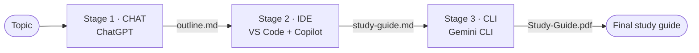

# Multi-Stage AI Workflow: Study Guide Creator

**Lab:** Multi-Stage AI Workflow Across UX Types
**Author:** Irimaso Maurice

A three-stage AI workflow that turns a **topic name** into a **finished 33-page study guide PDF** by chaining three AI tools from different UX types: **Chat → IDE → CLI**. Each stage's output file becomes the next stage's input.

**Demo topic:** Agile and Scrum · **Final output:** [Study-Guide.pdf](docs/outputs/Study-Guide.pdf)

---

## Workflow



| Stage | UX type | Tool | Input | Output | Time |
|---|---|---|---|---|---|
| 1 | Chat | ChatGPT | Topic | [outline.md](docs/outputs/outline.md): 8 sections, 35 subtopics | ~1 min |
| 2 | IDE | VS Code + GitHub Copilot | `outline.md` | [study-guide.md](docs/outputs/study-guide.md): full notes, examples, review questions | ~8 min |
| 3 | CLI | Gemini CLI | `study-guide.md` | [Study-Guide.pdf](docs/outputs/Study-Guide.pdf): title page, TOC, summary, answer key (33 pages) | ~20 min |

**Total: ~30 minutes, compared with ~4 hours by hand.** See [efficiency](docs/07-efficiency.md).

Full diagram with human review checkpoints: [02-workflow-diagram.md](docs/02-workflow-diagram.md)

---

## Documentation

| # | Document | Covers |
|---|---|---|
| 01 | [Problem statement](docs/01-problem.md) | The problem, why it splits into stages, success criteria |
| 02 | [Workflow diagram](docs/02-workflow-diagram.md) | Stages, handoffs, review points |
| 03 | [Stage 1: Chat](docs/03-stage1-chat.md) | ChatGPT run, output check, evidence |
| 04 | [Stage 2: IDE](docs/04-stage2-ide.md) | Copilot run, output check, evidence |
| 05 | [Stage 3: CLI](docs/05-stage3-cli.md) | Gemini CLI run, PDF export, evidence |
| 06 | [Adaptability](docs/06-adaptability.md) | Tool swap table, why it's tool-agnostic |
| 07 | [Efficiency](docs/07-efficiency.md) | Manual vs AI time, steps removed |
| 08 | [Lessons learned](docs/08-lessons-learned.md) | What worked, issues, improvements |

**Reusable prompts:** [Stage 1](docs/prompts/stage1-chat-prompt.md) · [Stage 2](docs/prompts/stage2-ide-prompt.md) · [Stage 3](docs/prompts/stage3-cli-prompt.md)
**Screenshots:** [docs/screenshots/](docs/screenshots/)

---

## How to Reproduce (any topic)
1. **Chat:** paste [stage1-chat-prompt.md](docs/prompts/stage1-chat-prompt.md) into any chat AI with your topic, and save the response as `docs/outputs/outline.md`.
2. **IDE:** copy it to `study-guide.md`, open it in an AI-enabled IDE and run [stage2-ide-prompt.md](docs/prompts/stage2-ide-prompt.md).
3. **CLI:** in a terminal in the project folder, start any CLI AI and run [stage3-cli-prompt.md](docs/prompts/stage3-cli-prompt.md).
4. Open `docs/outputs/Study-Guide.pdf`.

---

## Evaluation Criteria

| Criteria | How it's met |
|---|---|
| **Functionality (40%)** | Ran end-to-end from topic to PDF; real outputs in [docs/outputs/](docs/outputs/), plus screenshots of every stage |
| **Adaptability (20%)** | Plain Markdown handoffs and saved prompts; Stage 3 was swapped from Claude Code to Gemini CLI mid-project with no changes ([details](docs/06-adaptability.md)) |
| **Documentation (20%)** | Mermaid diagram, numbered stage docs, this README |
| **Efficiency (20%)** | ~4 hrs → ~30 min (~88% less time) ([details](docs/07-efficiency.md)) |

---

## Repository Structure
```
├── README.md
└── docs/
    ├── 01-problem.md … 08-lessons-learned.md
    ├── prompts/       # reusable prompt for each stage
    ├── outputs/       # outline.md → study-guide.md → study-guide.html → Study-Guide.pdf
    └── screenshots/   # evidence from every stage
```
