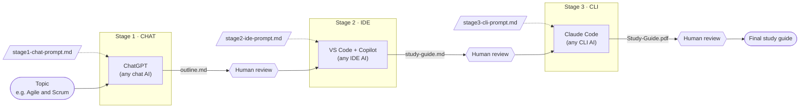

# 02: Workflow Diagram

## Overview

**Legend:** solid arrows show the file passed between stages · dotted arrows show the reusable prompt for each stage · hexagons are human review checkpoints.

## Stage Handoffs

| Stage | UX type | Tool (swappable) | Input | Prompt | Output | Handoff |
|---|---|---|---|---|---|---|
| 1 | Chat | ChatGPT | Topic name | [stage1-chat-prompt.md](prompts/stage1-chat-prompt.md) | `outputs/outline.md` | Copy the Markdown response into `outline.md` in the project |
| 2 | IDE | VS Code + GitHub Copilot | `outline.md` | [stage2-ide-prompt.md](prompts/stage2-ide-prompt.md) | `outputs/study-guide.md` | The file is saved in the project; the CLI reads it directly |
| 3 | CLI | Claude Code | `study-guide.md` | [stage3-cli-prompt.md](prompts/stage3-cli-prompt.md) | `outputs/Study-Guide.pdf` | Final deliverable |

## Human Review Checkpoints
1. **After Stage 1:** Is the outline complete and logically ordered? Edit headings if needed.
2. **After Stage 2:** Is every section filled in and accurate? Fix any wrong facts.
3. **After Stage 3:** Does the PDF open with a correct layout, table of contents and summary?

## Why This Design Is Tool-Agnostic
- Every handoff is a **plain Markdown file**, which any AI tool can read and write.
- Prompts are **saved as files**, so they can be pasted into any provider.
- The diagram names **UX types first, tools second**: each tool can be replaced without changing the flow.
