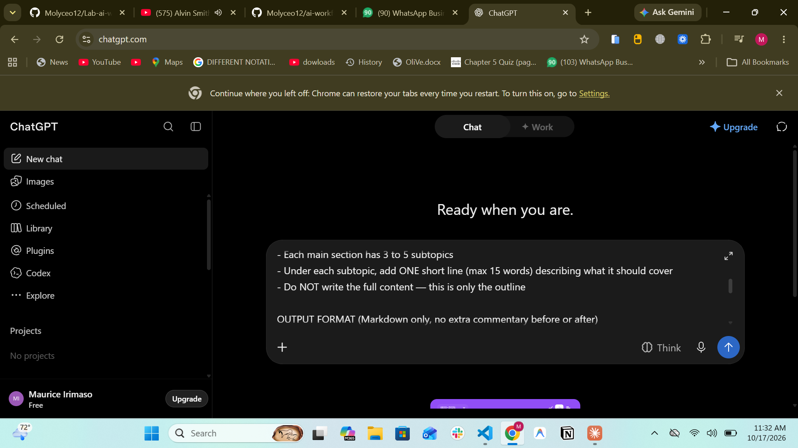
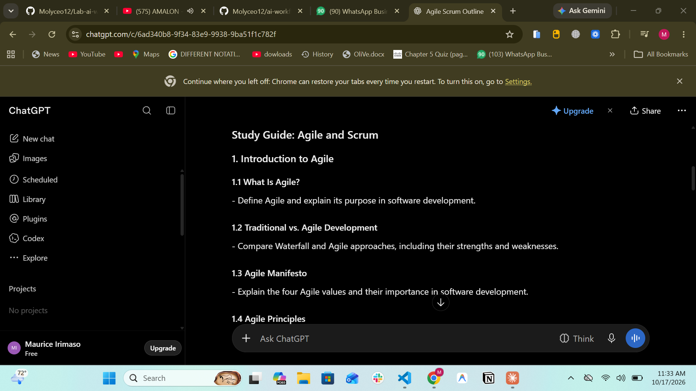
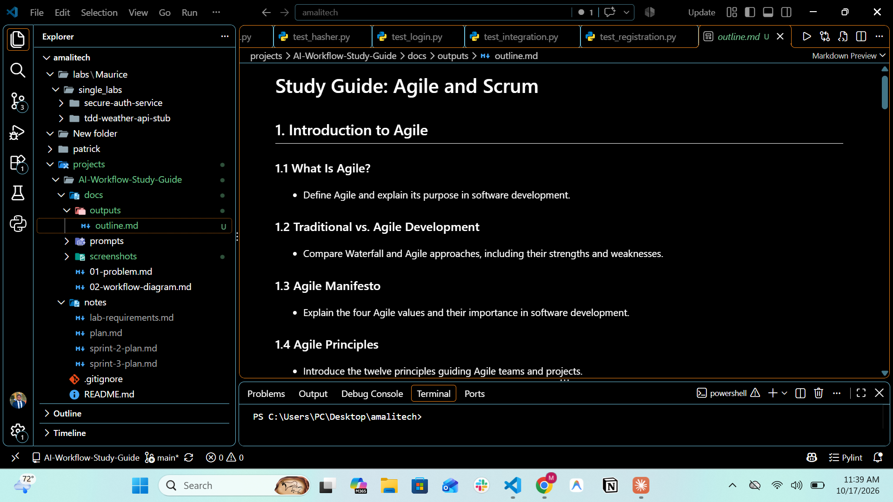

# 03: Stage 1, Chat (ChatGPT)

| | |
|---|---|
| **UX type** | Chat |
| **Tool** | ChatGPT (free plan); any chat AI works |
| **Input** | Topic: **Agile and Scrum** |
| **Prompt** | [prompts/stage1-chat-prompt.md](prompts/stage1-chat-prompt.md) |
| **Output** | [outputs/outline.md](outputs/outline.md) |
| **Time taken** | ~1 minute (11:32 → 11:33), plus copying and saving |

## What Happened
1. Opened a new chat in ChatGPT.
2. Pasted the Stage 1 prompt with `{{TOPIC}}` replaced by **Agile and Scrum**.
3. ChatGPT returned a Markdown outline in the requested format, with no extra commentary.
4. Copied the response with ChatGPT's copy button and saved it as `outputs/outline.md` in the project.

## Output Summary
- **8 sections**, ordered from fundamentals to advanced:
  1. Introduction to Agile
  2. Introduction to Scrum
  3. Scrum Roles and Responsibilities
  4. Scrum Artifacts and Commitments
  5. Scrum Events and Meetings
  6. Applying Agile and Scrum in Practice
  7. Agile and Scrum Tools and Metrics
  8. Advanced Scrum Practices and Challenges
- **35 subtopics** (4–5 per section), each with a one-line description (longest: 13 words)

**Excerpt:**
```markdown
# Study Guide: Agile and Scrum

## 1. Introduction to Agile

### 1.1 What Is Agile?
- Define Agile and explain its purpose in software development.

### 1.2 Traditional vs. Agile Development
- Compare Waterfall and Agile approaches, including their strengths and weaknesses.
```

## Output Check

| Check (from the prompt file) | Result |
|---|---|
| Starts with `# Study Guide: <topic>` | ✅ |
| 6–8 numbered `##` sections | ✅ 8 |
| 3–5 numbered `###` subtopics per section | ✅ 4–5 each |
| One description line per subtopic (≤ 15 words) | ✅ 35/35, max 13 words |
| No text outside the Markdown | ✅ |

## Handoff to Stage 2
`outputs/outline.md` is a plain Markdown file inside the project, so the IDE AI (VS Code + Copilot) can open and edit it directly. Stage 2 keeps every heading and replaces each one-line description with full study notes.

## Issues and Human Edits
- **Escaped characters:** copying from ChatGPT added a `\` before each bullet (`\-`). These were removed when saving the file. No content was changed.
- **Spacing:** blank lines between headings and bullets were tidied for consistency.

## Evidence

| Screenshot | Shows |
|---|---|
|  | The Stage 1 prompt entered in a new ChatGPT chat |
|  | ChatGPT's Markdown outline response |
|  | `outline.md` saved in the project and opened in VS Code |
