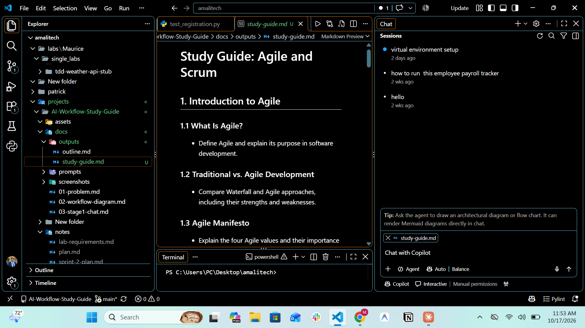
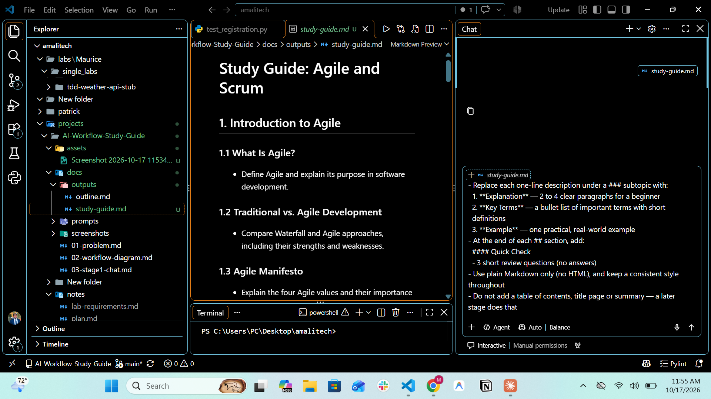
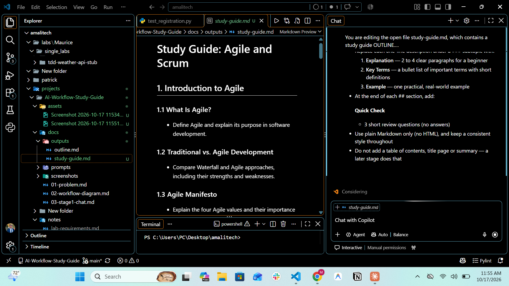
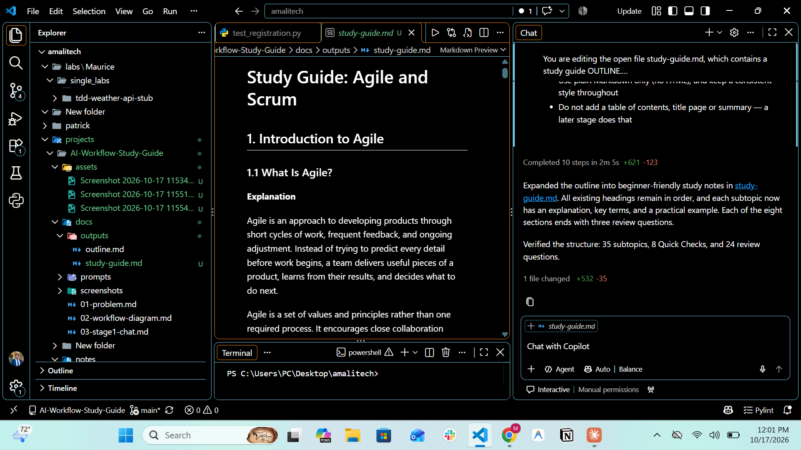

# 04: Stage 2, IDE (VS Code + GitHub Copilot)

| | |
|---|---|
| **UX type** | IDE |
| **Tool** | VS Code + GitHub Copilot Chat (Agent mode, Auto model); any IDE AI works |
| **Input** | [outputs/outline.md](outputs/outline.md), copied to `outputs/study-guide.md` as the starting file |
| **Prompt** | [prompts/stage2-ide-prompt.md](prompts/stage2-ide-prompt.md) |
| **Output** | [outputs/study-guide.md](outputs/study-guide.md) |
| **Time taken** | ~8 minutes in total (11:53 → 12:01); Copilot's run took **2 min 5 s** |

## What Happened
1. `outline.md` was copied to `study-guide.md`, so the original Stage 1 output stays unchanged.
2. `study-guide.md` was opened in VS Code and attached as context in Copilot Chat.
3. The Stage 2 prompt was pasted and sent in one go, covering all 8 sections.
4. Copilot completed **10 steps in 2 min 5 s** and edited the file in place: **1 file changed, +532 / −35 lines**.
5. Copilot verified its own result and reported 35 subtopics, 8 Quick Checks and 24 review questions.
6. The edits were kept and the file saved.

## Output Summary
- Grew from **~4 KB / 122 lines** (outline) to **~42 KB / 619 lines** (study notes)
- Every one of the **35 subtopics** now has an **Explanation**, **Key Terms** and an **Example**
- Every one of the **8 sections** ends with a **Quick Check** of 3 review questions (24 in total)

**Excerpt:**
```markdown
### 1.1 What Is Agile?
**Explanation**

Agile is an approach to developing products through short cycles of work,
frequent feedback, and ongoing adjustment. ...

**Key Terms**
- **Iteration:** A short period of work used to produce and review results.
- **Feedback:** Information from users or stakeholders that helps guide future work.
- **Adaptation:** Changing a plan or approach in response to what has been learned.

**Example**

A team building an online bookstore first releases search and book details. ...
```

## Output Check

| Check (from the prompt file) | Result |
|---|---|
| All original headings unchanged and in the same order | ✅ 44/44 identical |
| Every subtopic has an Explanation, Key Terms and an Example | ✅ 35/35 each |
| Every `##` section ends with a `#### Quick Check` | ✅ 8/8 |
| Plain Markdown, no HTML | ✅ 0 HTML tags |
| No table of contents, title page or summary yet | ✅ none |
| Only `study-guide.md` changed in the project | ✅ confirmed with `git status` |

## Handoff to Stage 3
`outputs/study-guide.md` is saved in the project, so the CLI AI (Claude Code) reads it directly from disk. Stage 3 adds the title page, table of contents, summary and answer key, and exports the PDF.

## Issues and Human Edits
- **Agent mode instead of Edit mode:** Copilot ran in Agent mode, which can touch any file. `git status` confirmed only `study-guide.md` changed, so no harm was done. For stricter control, Edit mode limits Copilot to the attached file.
- **No manual edits** were needed: the output passed every check as generated.

## Evidence

| Screenshot | Shows |
|---|---|
|  | `study-guide.md` (still an outline) open in VS Code, attached in Copilot Chat |
|  | The Stage 2 prompt entered in Copilot Chat |
|  | Copilot processing the request |
|  | Finished: 10 steps in 2 min 5 s, 1 file changed (+532 / −35), expanded notes shown in the preview |
