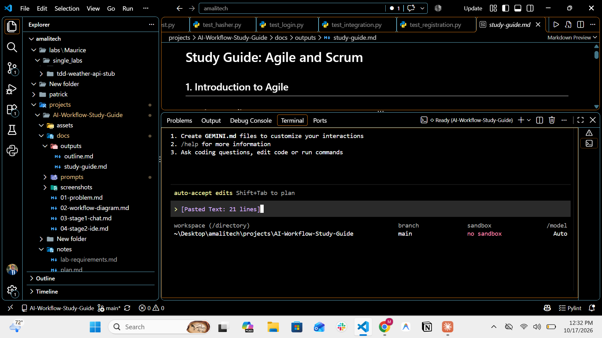
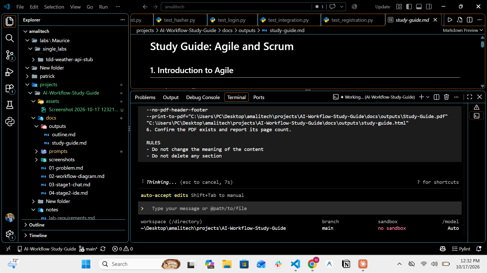

# 05: Stage 3, CLI (Gemini CLI)

| | |
|---|---|
| **UX type** | CLI |
| **Tool** | Gemini CLI v0.64.0 (free Gemini API key, Auto model); any CLI AI works |
| **Input** | [outputs/study-guide.md](outputs/study-guide.md) (from Stage 2) |
| **Prompt** | [prompts/stage3-cli-prompt.md](prompts/stage3-cli-prompt.md) |
| **Output** | [outputs/Study-Guide.pdf](outputs/Study-Guide.pdf) (33 pages), plus [outputs/study-guide.html](outputs/study-guide.html) |
| **Time taken** | ~20 minutes (12:32 → ~12:52) |

## What Happened
1. Opened a terminal in the project folder and started Gemini CLI (`gemini`).
2. Pasted the Stage 3 prompt (21 lines). Gemini read `study-guide.md` straight from disk, with no copy and paste needed.
3. **12:47:** Gemini saved the polished Markdown with a title page, table of contents, Summary and Answer Key.
4. **12:51:** Gemini wrote a styled `study-guide.html` with print margins and a page break before each section.
5. **PDF export:** the free API quota ran out just before Gemini could run its final command. The exact Edge command from the prompt was then run in the terminal to print the HTML to PDF:
   ```powershell
   & "C:\Program Files (x86)\Microsoft\Edge\Application\msedge.exe" --headless --disable-gpu --no-pdf-header-footer --print-to-pdf="...\docs\outputs\Study-Guide.pdf" "...\docs\outputs\study-guide.html"
   ```
6. Result: `Study-Guide.pdf`, **33 pages**.

## Output Summary
- **Title page:** "Study Guide: Agile and Scrum", subtitle, date
- **Table of contents:** links to all 8 sections, the Summary and the Answer Key
- **All content kept:** 35 subtopics and 8 Quick Checks, so nothing was lost from Stage 2
- **Summary:** 8 key-idea bullets
- **Answer Key:** answers to every Quick Check question
- Grew from 619 to **716 lines** of Markdown, then became an 80 KB HTML file and a 33-page PDF

## Output Check

| Check (from the prompt file) | Result |
|---|---|
| Title page and table of contents at the start | ✅ |
| Summary and Answer Key at the end | ✅ 8 summary bullets |
| No sections lost compared with Stage 2 | ✅ 35/35 subtopics, 8/8 Quick Checks |
| HTML is complete, with page breaks and margins | ✅ 11 sections, `@page` and page-break CSS |
| PDF exists | ✅ 33 pages |

## Handoff
This is the final stage. `Study-Guide.pdf` is the finished deliverable of the workflow.

## Issues and Human Edits
- **Claude Code CLI needs a paid plan**, so Gemini CLI was used instead. Only the Stage 3 tool changed: the prompt, the files and the flow stayed the same. This shows the workflow doesn't depend on one tool (see [06-adaptability.md](06-adaptability.md)).
- **Google sign-in failed**, so a free Gemini API key from Google AI Studio was used.
- **No pandoc on the machine**, so the PDF was printed from HTML with Microsoft Edge in headless mode.
- **Free-tier quota ran out** before the final print command. That one command was run manually, exactly as written in the prompt.
- **Slow on the free tier:** ~20 minutes, mostly spent regenerating ~50 KB of Markdown and ~80 KB of HTML.

## Evidence

| Screenshot | Shows |
|---|---|
|  | The Stage 3 prompt pasted into Gemini CLI in the project folder |
|  | Gemini CLI processing the request |
